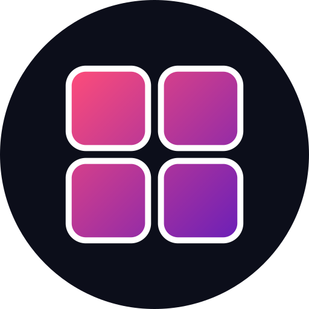
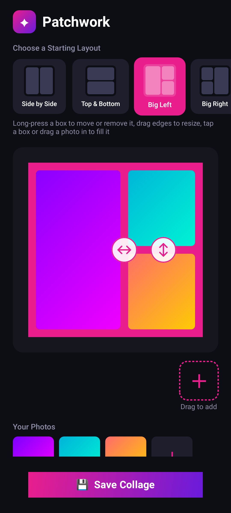
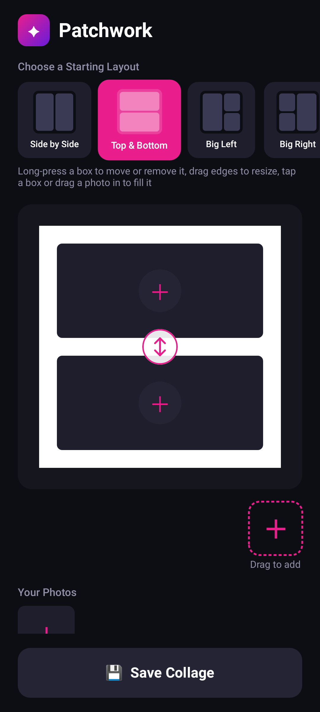

<!-- Generated from readme.yml by LukeNeedham/ci-workflows (docs/readme.md). Edit readme.yml, not this file. -->
<p align="center">
  
</p>

# Patchwork

A fast, native collage studio for Android, built with Jetpack Compose.

## Description

Patchwork is a native Android collage studio built with Jetpack Compose for speed, precision and aesthetic
control. It uses a custom-built rendering engine rather than heavy external libraries, which gives high-resolution
exports and a smooth UI on phones.

Start from one of 10 layouts, from a single frame to a six-photo asymmetric grid, then make it your own: long-press a
box to move or remove it, drag its edges to resize, and tap a box or drag a photo in to fill it. Rotate or zoom
individual photos, set the border thickness (0 to 40 px) with a slider, and pick a solid colour from a full-spectrum
picker or one of 26 neon, cyberpunk, holographic and vaporwave gradient borders. A collage is rendered to a crisp
1080×1080 px image and saved straight to your Gallery.

## Screenshots




## Getting started as a user

1. Install the latest build from the [AppHub](https://www.lukeneedham.com/apphub) app, or download the APK from the [Releases](https://github.com/LukeNeedham/Patchwork/releases) page.

Requires Android 7.0 (API 24) or newer.

## Getting started as a developer

Requirements: JDK 17 and the Android SDK (platform 36), for example through Android Studio.

```
git clone https://github.com/LukeNeedham/Patchwork.git
cd Patchwork
./gradlew assembleDebug    # the APK is in app/build/outputs/apk/debug/
./gradlew test             # unit tests
```

Every pull request is built by CI, which comments on it with a link to install the APK.

Like all my apps, it follows the shared architecture and conventions (single activity, Jetpack Compose, Navigation 3, MVVM with every page split into a `Page` and a `PageContent`, Koin): see [ci-workflows](https://github.com/LukeNeedham/ci-workflows/blob/main/docs/new-app.md).

The collage layouts are trees of boxes and splits (`CollageLayoutTree.kt`, starting points in `CollageLayouts.kt`),
edited on the canvas in `LayoutEditor.kt` and rendered for export by `CollageRenderer.kt`.

## Contributing

Branch from `main`, make the change, and open a pull request. CI must be green before it is merged.

## License

Apache 2.0. See [LICENSE](LICENSE).
